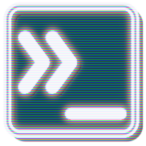
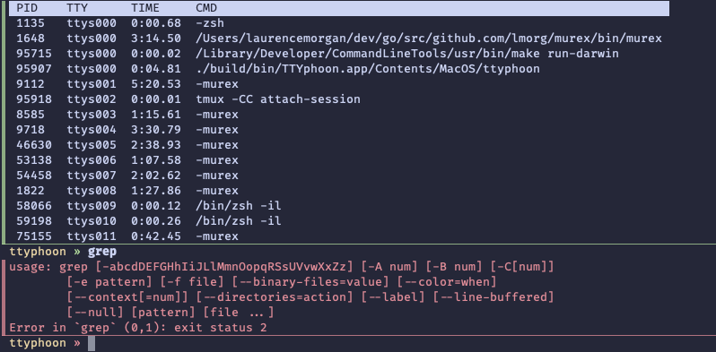
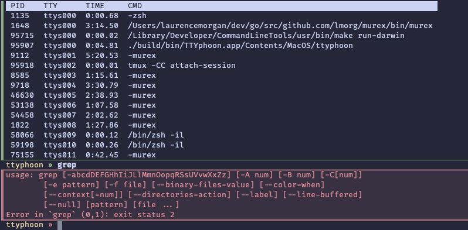
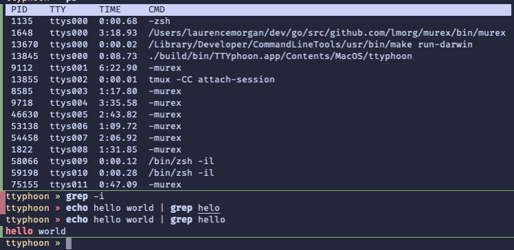
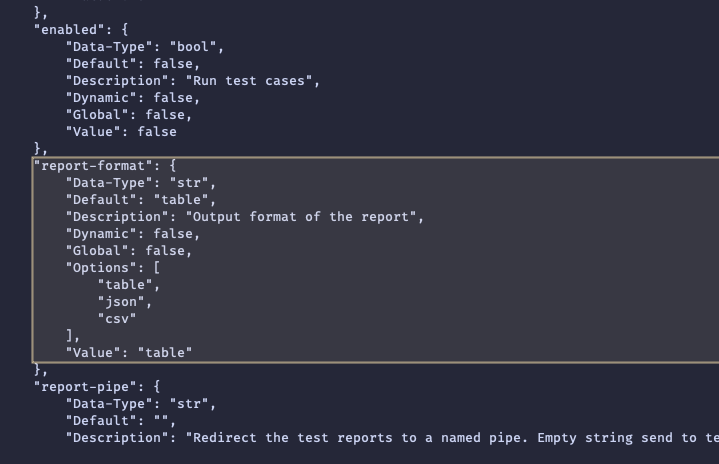
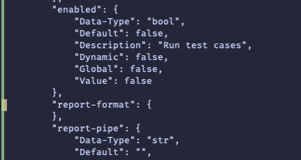
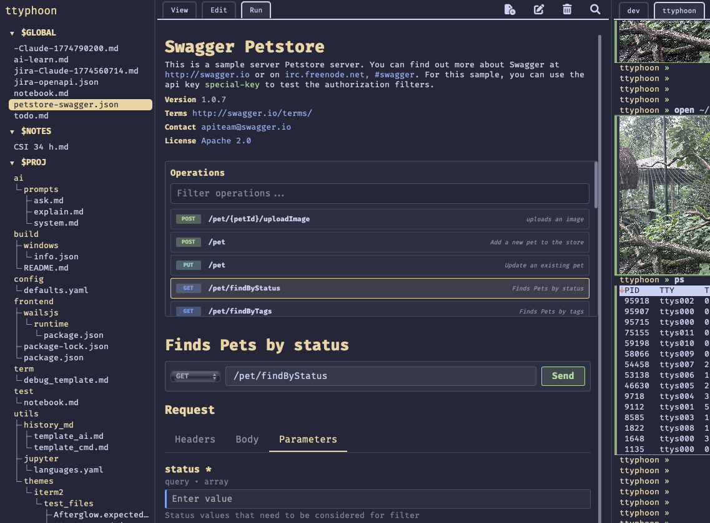
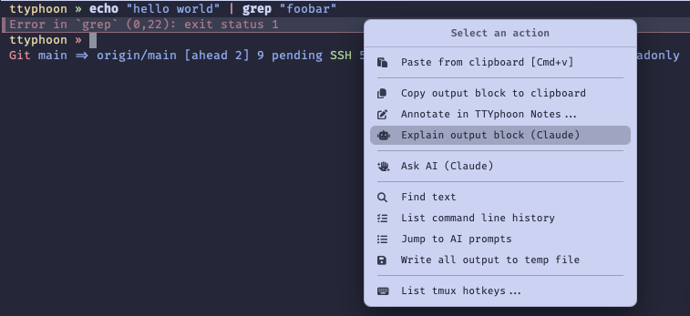

<h1>TTYphoon</h1>



- [Multimedia Terminal Emulator](#multimedia-terminal-emulator)
- [Terminal Features](#terminal-features)
  - [Output Blocks](#output-blocks)
  - [Structured Text](#structured-text)
  - [Tables](#tables)
  - [Images](#images)
  - [Tmux Support](#tmux-support)
  - [Highlighted Search Results](#highlighted-search-results)
- [IDE](#ide)
  - [Programming Language Tools (LSP)](#programming-language-tools-lsp)
  - [Markdown Viewer](#markdown-viewer)
    - [Executable Notebooks](#executable-notebooks)
    - [Structured Data Documents](#structured-data-documents)
  - [Spreadsheets](#spreadsheets)
  - [Vim-style Editor Keys](#vim-style-editor-keys)
  - [Swagger](#swagger)
  - [Hex Viewer](#hex-viewer)
  - [Non-Intrusive AI](#non-intrusive-ai)
- [How It Works](#how-it-works)
- [Whats Left To Do](#whats-left-to-do)
  - [Escape Codes](#escape-codes)
    - [TTYphoon / mxtty commands](#ttyphoon--mxtty-commands)
    - [VT100](#vt100)
    - [VT52 mode](#vt52-mode)
    - [VT200 mode](#vt200-mode)
    - [Tektronix 4014 mode](#tektronix-4014-mode)
    - [Window management codes](#window-management-codes)
    - [Extended features](#extended-features)
    - [Common application support](#common-application-support)
  - [Application Usability](#application-usability)
- [Supported Platforms](#supported-platforms)
- [Install Guide](#install-guide)
  - [Configuration reference](#configuration-reference)
- [How To Support](#how-to-support)

## Multimedia Terminal Emulator

The aim of this project is to provide an easy to use terminal emulator that
supports inlining multimedia widgets.

Currently the project is _very_ alpha.

The idea behind this terminal emulator is that is can be used by any $SHELL,
however hooks will be built into [Murex](https://github.com/lmorg/murex) so
the terminal will be instantly usable even before wider support across other
shells and command line applications is adopted.

At its heart, TTYphoon is a regular terminal emulator. Like Kitty, iTerm2, and
PuTTY (to name a few). But where TTYphoon differs is that it also supports
inlining rich content. Some terminal emulators support inlining images. Others
might also allow videos. But none bar some edge case Electron terminals offer
collapsible trees for JSON printouts. Easy to navigate directory views. Nor any
other interactive elements that we have come to expect on modern user
interfaces.

The few terminal emulators that do attempt to offer this usually fail to be
good, or even just compatible, with all the CLI tools that we've come to depend
on.

TTYphoon aims to do _both well_. Even if you never want for any interactive
widgets, TTYphoon will be a good terminal emulator. And for those who want a
little more GUI in their CLI, TTYphoon will be a great modern user interface.

## Terminal Features

### Output Blocks

Command output is grouped into blocks to make it easier to visually see the
separation between different command output.

Those blocks are coloured too, to help identify whether a command succeeded or
failed.



Those blocks can be highlighted by hovering over them



And even collapsed, hidden from view



### Structured Text

IDE-like tools for working with structured text, like JSON. Hover over a branch
to highlight its child nodes



Click to collapse that block of text



### Tables

Output can be presented as tables. Which can be sorted and even filtered using
SQL. All without having to rerun the commands that generated that output


### Images

Support for inlined images, where images are treated as images. for example
they can be copied to clipboard


Clipboard images can also be uploaded to S3. See the
[configuration reference](docs/Configuration.md#socials3).

### Tmux Support

Terminal multiplexing support is built in using tmux's control plane. This allows for the power of
tmux but with the ease of use and elegance of being fully integrated into the
terminal emulator


(in this screenshot, tmux's prefix key was rebinded to `F2` in `~/.tmux.conf`)

### Highlighted Search Results

Search terms can be highlighted to quickly find instances of that term


## IDE

### Programming Language Tools (LSP)

See the [configuration reference](docs/Configuration.md#notes-language-servers-and-executable-notebooks)
for language server and spellchecker settings.

### Markdown Viewer

You can write notes in markdown alongside your terminal sessions. View readme's, have your documentation with you instead of switching between windows


#### Executable Notebooks

You can even execute the code blocks inline. Bringing you the flexibility of Jupyter Notebooks and the power of a full terminal emulator


#### Structured Data Documents

Work with JSON, YAML and XML config files more easily


### Spreadsheets

CSV files can be edited directly inside the editor. You can even add algaberic operations


Or use markdown tables if you want to build your own formula functions


### Vim-style Editor Keys

The Notes editor and Jupyter code blocks support Vim-style keyboard navigation. See [docs/Vim-Editor-Keys.md](docs/Vim-Editor-Keys.md) for the full keybinding reference.

For Notes document tabs and split-view shortcuts, see [docs/Notes-Shortcuts.md](docs/Notes-Shortcuts.md).

### Swagger

Native support for Swagger and OpenAPI files. So you don't need to be a `curl` expert all of the time



### Hex Viewer

Sometimes you just need to view the raw bytes of a file


### Non-Intrusive AI

AI is crammed everywhere - even where you don't want it. TTYphoon integrates AI but does so non-intrusively. It's there if you need to quickly debug something. Or want to quickly generate code. Or not there if you prefer. It isn't a clown constantly fighting you for your attention.



## How It Works

TTYphoon native code in the backend to provide fast computation and then pushes the last mile rendering to webkit.

This ensures that the terminal reuses performant existing technologies which have already been fine-tuned by larger organisations like Apple, Microsoft and Google. But without the _massive_ overhead of running Electron or other Chrome-based solutions.

The multimedia and interactive components will be passed from the controlling
terminal applications via ANSI escape sequences. Before groan, yes I agree that
in-band escape sequences are a lousy way of encoding meta-information. However
to succeed at being a good terminal emulator, it needs to support some historic
design decisions no matter how archaic they might seem today. This allows
TTYphoon to work with existing terminal applications _and_ for third parties to
easily add support for their applications to render rich content in TTYphoon
without breaking compatibility for legacy terminal emulators.

## Whats Left To Do

In short, _a lot_!! Some of what has been detailed above is still in a _very_
alpha state. And while there is lots of error handling and unit tests, test
coverage is still pretty low.

Below is a high level TODO list of features and compatibility. If an item is
ticked but not working as expected, then please raise an issue in Github.

### Escape Codes

#### TTYphoon / mxtty commands

All proprietary APC commands are also supported under OSC 1701. The command,
subcommand, and optional JSON parameters are identical:

```text
ESC _ begin;csv ESC \
ESC ] 1701;begin;csv ESC \
```

Both forms accept `ESC \` (ST) or BEL as the terminator. Existing APC producers
remain compatible; Kitty graphics continues to use its separate APC protocol.
This adds a terminal parser alias, not new command names or tmux passthrough
configuration.

#### VT100

- C1 codes
  - [x] common: can run most CLI applications
  - [x] broad: can run older or more CLI applications
  - [ ] complete: xterm compatible
- CSI codes
  - [x] common: can run most CLI applications
  - [x] broad: can run older or more complicated CLI applications
  - [ ] complete: xterm compatible
- SGR codes
  - [x] common: can run most CLI applications
  - [x] broad: can run older or more complicated CLI applications
  - [ ] complete: xterm compatible
  - [ ] extended underline: kitty compatible
- OSC codes
  - [x] common: can run most CLI applications
  - [x] broad: can run older or more complicated CLI applications
  - [ ] complete: xterm compatible
- DCS codes
  - [ ] common: can run most CLI applications
  - [ ] broad: can run older or more complicated CLI applications
  - [ ] complete: xterm compatible
- [x] Alt character sets
- [x] Wide characters
  - [ ] vt100 (ASCII characters)
  - [x] Unicode (eg logograph-centric languages and emoticons)
- Keyboard
  - [x] Ctrl modifiers
  - [x] Alt modifiers
  - [x] Shift modifiers
  - [x] special keys (eg function keys, number pad, etc)
    - [ ] glitch free (some bugs still exist)
  - [x] tmux support for modifiers
- Mouse tracking
  - [x] common: can run most CLI applications
  - [x] broad: can run older or more complicated CLI applications
  - [ ] complete: xterm compatible

#### VT52 mode

- [ ] cursor movements
- [ ] special modes

#### VT200 mode

Some compatibility already exists. Detailed breakdown coming...

#### Tektronix 4014 mode

- [ ] graphics plotting
- [ ] text rendering

#### Window management codes

eg `xterm` and similar terminal emulators

- [x] titlebar can be changed
- [ ] ~~window can be moved and resized (WILL NOT IMPLEMENT)~~
- [ ] window can be minimized and restored

#### Extended features

- [x] Hyperlink support
  - [x] Auto-hyperlink files
  - [x] Auto-hyperlink URLs
  - [x] OSC 8 application-provided hyperlinks (enabled by default)
- [ ] Bracketed paste mode
- [x] Inlining images
  - [x] TTYphoon codes
  - [ ] iterm2 compatible
  - [ ] Kitty compatible
  - [x] sixel graphics
  - [ ] ReGIS graphics
- [x] Code folding
- [x] Table sorting
  - [x] alpha: available but expect changes to the API
  - [x] stable: available to use in Murex

#### Common application support

- [x] Supports `tmux`
  - [x] usable from CLI
  - [x] glitch-free from CLI
  - [x] tmux control mode supported
- [x] Supports `vim`
  - [x] usable
  - [x] glitch-free
- [x] Supports `murex`
  - [x] usable
  - [x] glitch-free

### Application Usability

- [x] Terminal can be resized
- [x] Scrollback history
  - [x] usability hints added
- [x] discoverability hints added
- [x] Typeface can be changed
- [x] Colour scheme can be changed
  - [x] supports iTerm2 colour themes
- [ ] Bell can be changed
- [x] Default term size can be changed
- [x] Default command / shell can be changed

## Supported Platforms

Support for the following platforms is planned:

- [x] Linux
  - [x] tested on Arch
  - [ ] tested on Ubuntu
  - [ ] tested on Rocky
- [ ] BSD
  - [ ] tested on FreeBSD
  - [ ] tested on NetBSD
  - [ ] tested on OpenBSD
  - [ ] tested on DragonflyBSD
- [x] macOS
  - [ ] tested on 12.x, Monterey
  - [ ] tested on 13.x, Ventura
  - [x] tested on 14.x, Sonoma
  - [x] tested on 15.x, Sequoia
- [ ] Windows
  - [ ] PTY support implemented
  - [ ] tested on Windows 10
  - [ ] tested on Windows 11

## Install Guide

Currently TTYphoon can only be compiled from source.

To do so you will need the following installed:
- C compiler (eg GNU C)
- Go compiler
- [wails](https://wails.io/) command line tool
- GNU Make (available by default on POSIX systems)

Aside from that, it's as easy as running `make build` from the git repository
root directory.

### Configuration reference

See the [configuration reference](docs/Configuration.md) for supported files,
locations and schemas.

## How To Support

Regardless of your time and skill set, there are multiple ways you can support
this project:

- **Contributing code**: This could be bug fixes, new features, or even just
  correcting any typos.

- **Testing**: There is a plethora of different software that needs to run
  inside a terminal emulator and a multitude of distinct platforms that this
  could run on. Any support testing TTYphoon would be greatly appreciated.

- **Documentation**: This is possibly the hardest part of any project to get
  right. Eventually documentation for this will follow the same structure as
  [Murex Rocks](https://murex.rocks) (albeit its own website) however, for now,
  any documentation written in markdown is better than none.

- **Architecture discussions**: I'm always open to discussing code theory. And
  if it results in building a better terminal emulator, then that is a
  worthwhile discussion to have.

- **Porting escape codes to other applications**: Currently [Murex](https://github.com/lmorg/murex)
  is the pioneer for supporting TTYphoon-specific ANSI escape codes. However it
  would be good to see some of these extensions expanded out further. Maybe
  even to a point where this terminal emulator isn't required any more than a
  place to beta test future proposed escape sequences.
